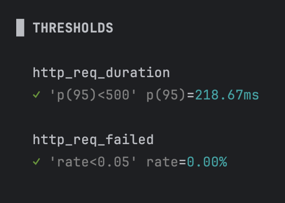
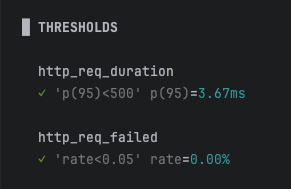
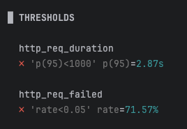

# 부하 테스트 보고서

## 개요 

커머스 서비스에서 발생할 수 있는 부하를 테스트해보고, 서비스가 안정적으로 운영될 수 있는지 확인합니다.

## 테스트 환경
- M1 MacBook Pro
- 16GB RAM
- k6 사용
- docker-compose 로 서비스 실행

## 테스트 시나리오 및 목표
- 결제
  - 시나리오
    - load test 를 진행하여 결제 로직이 잘 동작되는지 확인합니다.
    - 처음 10초는 RPS=0 -> RPS=100 까지 선형적으로 증가시킵니다.
    - 이후 1분간 RPS=100 을 유지합니다.
    - 마지막 10초는 RPS=100 -> RPS=0 까지 선형적으로 감소시킵니다.
  - 목표
    - 목표 RPS 는 100 으로 설정했습니다.
    - 목표 p95 응답 시간은 500ms 이하로 설정했습니다.
    - 목표 에러율은 5% 이하로 설정했습니다.
- 선착순 쿠폰 발급
  - 시나리오
    - 짧은 시간 내 대량의 트래픽을 받기 때문에 peak test 를 진행했습니다.
    - 10000 개 발행 제한이 있는 쿠폰에 대해서 진행합니다.
  - 목표
    - 목표 RPS 는 1000 으로 설정했습니다.
    - 목표 p95 응답 시간은 1s 이하로 설정했습니다.
    - 목표 에러율은 5% 이하로 설정했습니다. (발급 개수 제한 이전의 에러만 고려)
- 인기 상품 조회
  - 시나리오
    - load test 를 진행하여 인기 상품 조회 API 가 잘 동작되는지 확인합니다.
    - 처음 10초는 RPS=0 -> RPS=1000 까지 선형적으로 증가시킵니다.
    - 이후 1분간 RPS=1000 을 유지합니다.
    - 마지막 10초는 RPS=1000 -> RPS=0 까지 선형적으로 감소시킵니다.
  - 목표
    - 목표 RPS 는 1000 으로 설정했습니다.
    - 목표 p95 응답 시간은 500ms 이하로 설정했습니다.
    - 목표 에러율은 5% 이하로 설정했습니다.

## 테스트 진행
- k6 스크립트 작성
  - [결제](../../k6/order.js)
  - [선착순 쿠폰 발급](../../k6/issue-coupon.js)
  - [인기 상품 조회](../../k6/popular-product.js)
- k6 실행
  - ```K6_WEB_DASHBOARD=true DASHBOARD=true K6_WEB_DASHBOARD_EXPORT=[테스트 결과 파일명] k6 run [스크립트 파일명]```

## 테스트 결과 및 분석
1. 결제 요청

[결제 요청 결과 리포트](../../k6/order-report.html)
- p95 응답 시간: 218ms
- 에러율: 0.00%
- 현재 설정으로는 RPS 100 까지는 무리 없이 처리할 수 있음을 확인했습니다.

2. 인기 상품 조회 요청

[인기 상품 조회 요청 결과 리포트](../../k6/popular-product-report.html)
- p95 응답 시간: 3.67ms
- 에러율: 0.00%
- 현재 설정으로는 RPS 1000 까지는 무리 없이 처리할 수 있음을 확인했습니다.

3. 선착순 쿠폰 발급 요청

[선착순 쿠폰 발급 요청 결과 리포트](../../k6/issue-coupon-report.html)
- p95 응답 시간: 2.87s
- 에러율: 71.57%
- p95 성능이 기대치에 미달되었다.
- 최대 발급량 초과 이후 요청을 제외하고는 0%가 나왔다.

## API 개선안
- 선착순 쿠폰 발급 요청
  - 서버, kafka, DB 의 수직 확장
  - 서버 앞단에 ALB 를 추가하여 부하 분산 진행